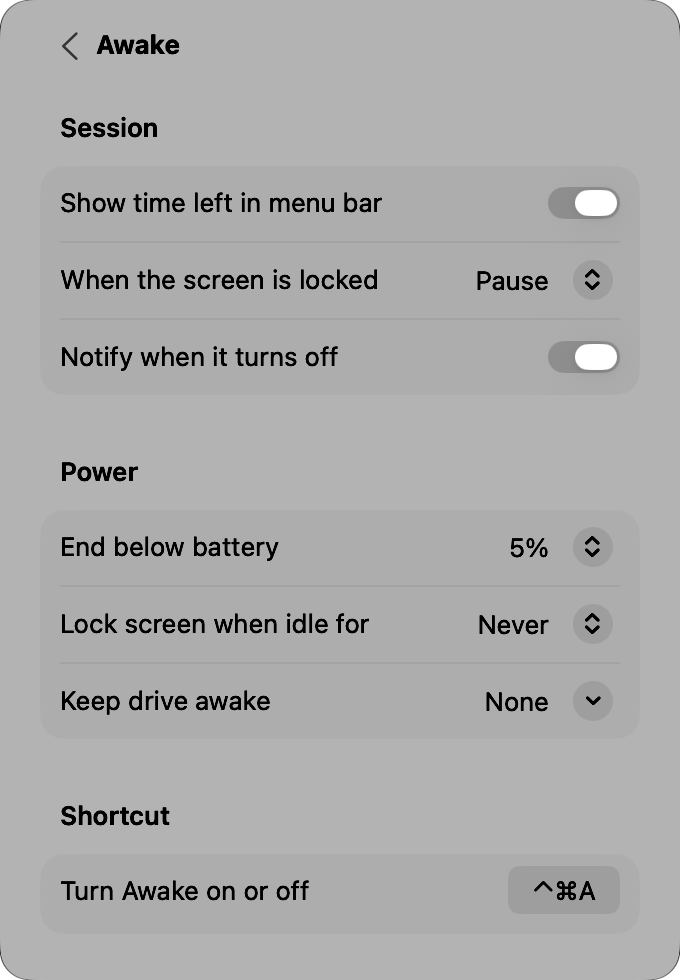
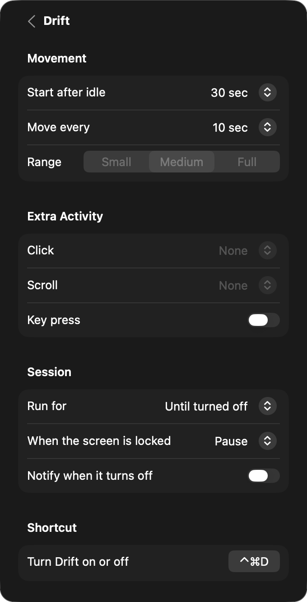

# Driftly

A native macOS menu-bar app with two features:

- **Awake** keeps your Mac from sleeping, for as long as you need or automatically when something happens.
- **Drift** keeps your status active by gently moving the cursor.

Each one has its own switch, settings and shortcut, so you can run either or both. Driftly is free, has no in-app purchases, and lives entirely in one menu-bar panel.

<p>
  
  
</p>

## Features

Every option has exactly one place. Each feature's card on the main panel holds its everyday controls, its own page holds the rest, triggers only decide when a feature turns on, and Settings holds what both share.

- **Awake:**
  - **Duration:** until turned off, 15 minutes to 8 hours, or until a time. Picking a new duration while it's on restarts the countdown.
  - **Display:** stays on, or can sleep while the Mac stays awake.
  - **Options page:** time left in the menu bar, pause or keep going while the screen is locked, a notification when it turns off on its own, turn off below a battery level, lock the screen after idle time, keep an external drive from sleeping, and its shortcut (default ⌃⌘A).
- **Drift:**
  - **Style:** Standard (straight moves), Natural (curved paths and varied timing), or Silent (no cursor movement).
  - **Options page:**
    - **Movement:** start after a set idle time and move again at a set interval, in a small, medium or full-screen range.
    - **Extra activity:** clicks at saved positions, a scroll that returns, or a bare Control tap that types nothing.
    - **Session:** run until turned off, for a set time, or until a time; pause or keep going while locked; a notification when it turns off.
    - **Shortcut:** default ⌃⌘D.
  - **Smart pausing:** Drift pauses when you use the mouse or keyboard, when you switch users, when the Mac sleeps or the screensaver starts, while a menu is open and during screenshots.
- **Triggers** turn Awake, Drift or both on automatically, and off again when they stop matching:
  - schedule (weekdays and hours, overnight supported)
  - an app running or in front
  - charger connected, on battery, or battery above a level
  - external display or screen mirroring
  - a USB or Bluetooth device connected
  - a Wi-Fi network or a VPN
  - an audio output device
  - a drive mounted
  - a download in progress
  - CPU busier than a threshold
- **Settings:**
  - **Menu bar:** nine icons, which feature lights the icon up, and dimming when off.
  - **General:** open at login.
  - **Statistics:** time Awake and Drift were on today and this week.
  - **Permissions:** shows whether each one is granted and opens System Settings.

<p>
  
  
</p>
<p>
  
  
</p>

## Design

- **Stock controls only:** every control is a standard SwiftUI/AppKit control in a System Settings–style grouped form.
- **Follows the system:** materials, Liquid Glass (macOS 26+), light and dark mode, accent colour, Reduce Transparency and Reduce Motion all come from macOS.
- **Measured spacing:** the panel has 20pt margins on every side, and all content lines up on one 30pt edge. The values are in [`DesignSystem.swift`](Driftly/DesignSystem.swift).
- **Balanced layout:** the Awake and Drift cards have the same shape: a header with a ring and switch, two quick settings, and a link to their options.
- **Keyboard and VoiceOver:** ⌘, opens Settings, ⌘Q quits, Esc goes back, and every icon-only button has a VoiceOver label.

## Requirements

- macOS 14 Sonoma or later. Liquid Glass appears on macOS 26 and later.
- Xcode 16 or later.

## Build and run

1. Open `Driftly.xcodeproj`.
2. Choose your signing team.
3. Run.

On first launch a welcome panel opens under the menu bar and walks you through two permissions:

- **Accessibility:** for Drift and for locking the screen.
- **Input Monitoring:** to notice when you're typing, so Driftly stays out of the way.

Some triggers ask once for their own access: Location for Wi-Fi network names, Bluetooth for Bluetooth devices, and the Downloads folder for download triggers.

### Design previews

Debug builds can show the panel in a borderless window for screenshots:

```bash
Driftly.app/Contents/MacOS/Driftly -preview main dark      # or: awake, drift, settings, triggers, editor, all · light, dark
```

## Project layout

| File | Role |
|---|---|
| `DriftlyApp.swift` | `MenuBarExtra` entry point, debug preview harness |
| `PanelView.swift` | Main page: Awake and Drift cards, shared rows |
| `FeaturePages.swift` | Awake and Drift option pages |
| `SettingsPage.swift` | In-panel settings, shortcut recorder, permissions |
| `DesignSystem.swift` | Layout metrics, icon tiles, fitted grouped form |
| `AppState.swift` | Controller: runs Awake and Drift independently, trigger hand-off, power assertions, simulated activity |
| `Triggers.swift` | Trigger model and the system checks behind each kind |
| `TriggersPage.swift` | Trigger list and editor |
| `Extras.swift` | Notifications, drive keep-alive, statistics |
| `Mover.swift` | One jiggle cycle: Bézier paths, clicks, scroll, key press |
| `InputPoster.swift` | `CGEvent` posting and permission checks |
| `Monitors.swift` | Real-activity detection, system pauses, power assertions |
| `Schedule.swift` | Schedule windows, "until" times and daily natural-mode jitter |
| `Config.swift` | Settings model with per-feature settings, persisted as JSON, migrates older versions |

See [`docs/SPEC.md`](docs/SPEC.md) for the full behaviour spec and the macOS APIs behind each feature.
