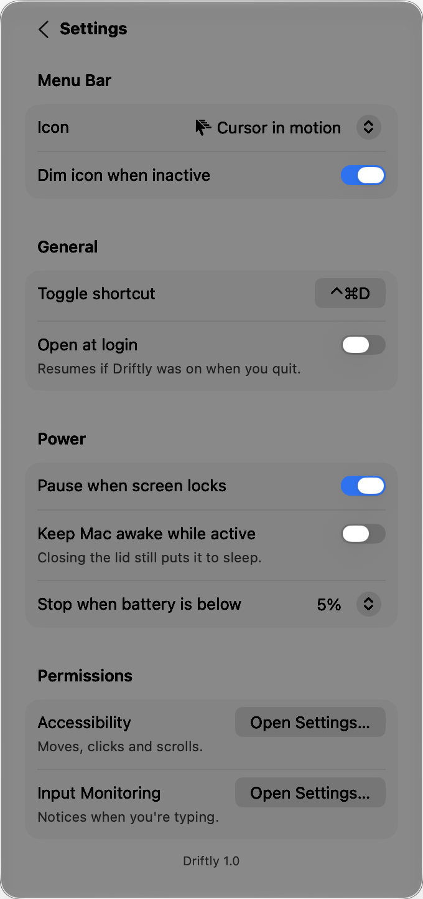

# Driftly

A native macOS menu-bar app that keeps your Mac active by gently moving the cursor when you step away. It's free, has no in-app purchases, and lives entirely in one menu-bar panel.

<p>
  
  
</p>

## Features

- **Three modes:**
  - **Standard:** straight, steady moves.
  - **Natural:** curved paths and varied timing, with schedule times shifted 1–5 minutes each day.
  - **Silent:** keeps you active without moving the cursor.
- **Movement:** start after a set idle time, move again at a set interval, and choose a small, medium or full-screen range.
- **Extra activity:**
  - **Click:** left, right or alternating clicks at saved screen positions.
  - **Scroll:** a small scroll that returns to where it started.
  - **Key press:** a bare Control tap that types nothing.
- **Schedule:** active hours on chosen weekdays, plus auto-stop at a set time or after a set duration.
- **App rules:** run only while chosen apps are running or in front, or pause while they're in front (useful for presentations).
- **Smart pausing:** pauses when you use the mouse or keyboard, when the screen is locked, when you switch users, when the Mac sleeps or the screensaver starts, while a menu is open, during screenshots, and when the battery is low.
- **Settings:**
  - **Menu bar:** nine icons, each with an on and off look.
  - **General:** a shortcut you can record (default ⌃⌘D) and open at login.
  - **Power:** keep the Mac awake while active.
  - **Permissions:** shows whether each one is granted and opens System Settings.

<p>
  
  
</p>

## Design

- **Stock controls only:** every control is a standard SwiftUI/AppKit control in a System Settings–style grouped form.
- **Follows the system:** materials, Liquid Glass (macOS 26+), light and dark mode, accent colour, Reduce Transparency and Reduce Motion all come from macOS.
- **Measured spacing:** the panel has 20pt margins on every side, and all content lines up on one 30pt edge. The values are in [`DesignSystem.swift`](Driftly/DesignSystem.swift).
- **Keyboard and VoiceOver:** ⌘, opens Settings, ⌘Q quits, Esc goes back, and every icon-only button has a VoiceOver label.

## Requirements

- macOS 14 Sonoma or later. Liquid Glass appears on macOS 26 and later.
- Xcode 16 or later.

## Build and run

1. Open `Driftly.xcodeproj`.
2. Choose your signing team.
3. Run.

The first time you turn Driftly on, macOS asks for two permissions:

- **Accessibility:** to move the cursor, click and scroll.
- **Input Monitoring:** to notice when you're typing, so Driftly stays out of the way.

### Design previews

Debug builds can show the panel in a borderless window for screenshots:

```bash
Driftly.app/Contents/MacOS/Driftly -preview main dark      # or: settings, all · light, dark
```

## Project layout

| File | Role |
|---|---|
| `DriftlyApp.swift` | `MenuBarExtra` entry point, debug preview harness |
| `PanelView.swift` | Main page and section rows |
| `SettingsPage.swift` | In-panel settings, shortcut recorder, permissions |
| `DesignSystem.swift` | Layout metrics, icon tiles, fitted grouped form |
| `AppState.swift` | Controller and state machine (schedule, auto-stop, battery, app rules) |
| `Mover.swift` | One jiggle cycle: Bézier paths, clicks, scroll, key press |
| `InputPoster.swift` | `CGEvent` posting and permission checks |
| `Monitors.swift` | Real-activity detection, system pauses, power assertions |
| `Schedule.swift` | Schedule windows and daily natural-mode jitter |
| `Config.swift` | Settings model, persisted as JSON |

See [`docs/SPEC.md`](docs/SPEC.md) for the full behaviour spec and the macOS APIs behind each feature.
