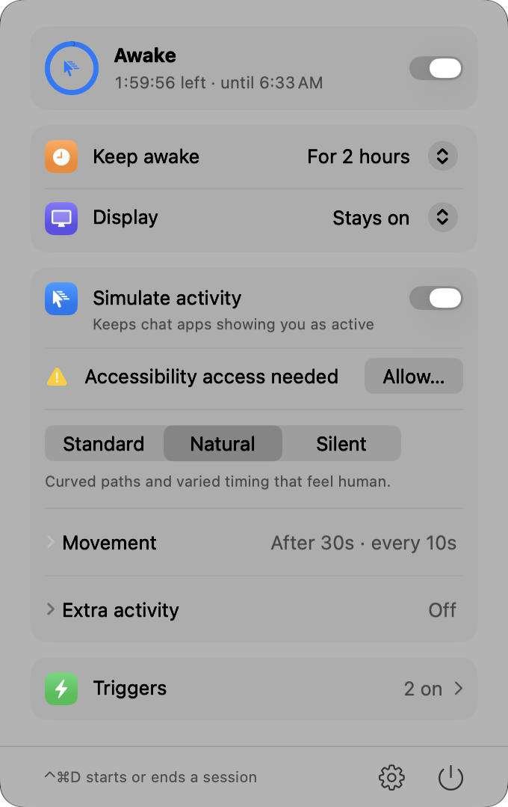
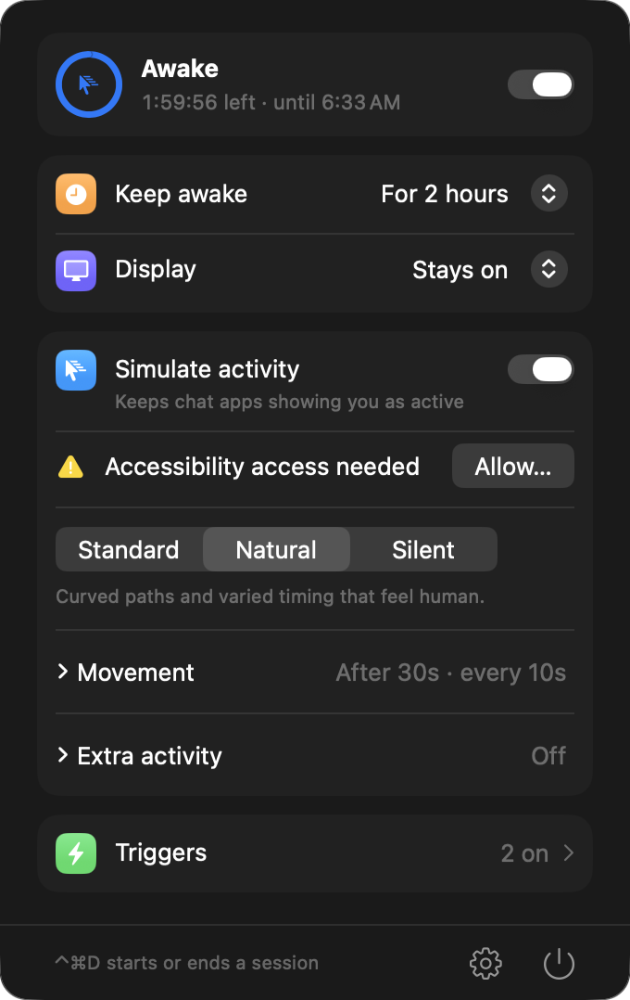
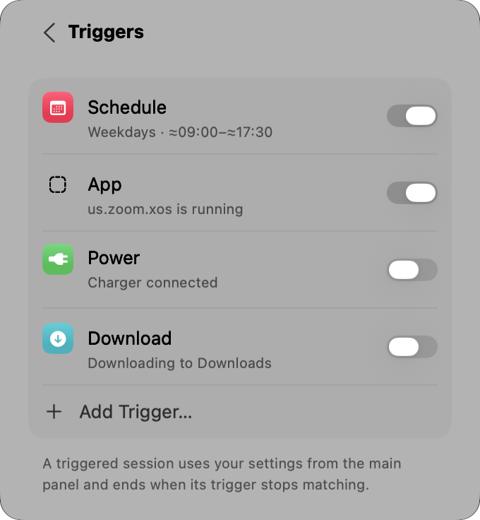
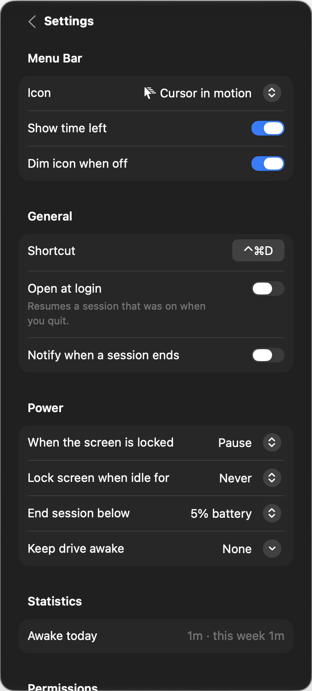

# Driftly

A native macOS menu-bar app that keeps your Mac awake, for as long as you need or automatically when something happens, and can keep your status active by gently moving the cursor. It's free, has no in-app purchases, and lives entirely in one menu-bar panel.

<p>
  
  
</p>

## Features

Every option has exactly one place: the session is set up on the main panel, triggers only decide when it starts, and everything else is in Settings.

- **Sessions:** keep the Mac awake indefinitely, for 15 minutes to 8 hours, or until a time. Choose whether the display stays on or can sleep. Picking a new length during a session restarts the countdown.
- **Simulate activity**, optional within a session:
  - **Modes:** Standard (straight moves), Natural (curved paths and varied timing), or Silent (no cursor movement).
  - **Movement:** start after a set idle time and move again at a set interval, in a small, medium or full-screen range.
  - **Extra activity:** clicks at saved positions, a scroll that returns, or a bare Control tap that types nothing.
- **Triggers** start a session automatically and end it when they stop matching:
  - schedule (weekdays and hours, overnight supported)
  - an app running or in front
  - charger connected, on battery, or battery above a level
  - external display or screen mirroring
  - a USB or Bluetooth device connected
  - a Wi-Fi network or a VPN
  - an audio output device
  - a drive mounted
  - a download in progress
  - CPU busier than a threshold
- **Smart pausing:** simulated activity pauses when you use the mouse or keyboard, when you switch users, when the Mac sleeps or the screensaver starts, while a menu is open and during screenshots.
- **Settings:**
  - **Menu bar:** nine icons, time left next to the icon, dim when off.
  - **General:** a recordable shortcut (default ⌃⌘D), open at login, and a notification when a session ends on its own.
  - **Power:** pause or keep going while the screen is locked, lock the screen after idle time, end the session below a battery level, and keep an external drive from sleeping.
  - **Statistics:** time awake today and this week.
  - **Permissions:** shows whether each one is granted and opens System Settings.

<p>
  
  
</p>

## Design

- **Stock controls only:** every control is a standard SwiftUI/AppKit control in a System Settings–style grouped form.
- **Follows the system:** materials, Liquid Glass (macOS 26+), light and dark mode, accent colour, Reduce Transparency and Reduce Motion all come from macOS.
- **Measured spacing:** the panel has 20pt margins on every side, and all content lines up on one 30pt edge. The values are in [`DesignSystem.swift`](Driftly/DesignSystem.swift).
- **Keyboard and VoiceOver:** ⌘, opens Settings, ⌘Q quits, Esc goes back, and every icon-only button has a VoiceOver label.

## Requirements

- macOS 14 Sonoma or later. Liquid Glass appears on macOS 26 and later.
- Xcode 16 or later.

## Build and run

1. Open `Driftly.xcodeproj`.
2. Choose your signing team.
3. Run.

On first launch a welcome panel opens under the menu bar and walks you through two permissions:

- **Accessibility:** to simulate activity and lock the screen.
- **Input Monitoring:** to notice when you're typing, so Driftly stays out of the way.

Some triggers ask once for their own access: Location for Wi-Fi network names, Bluetooth for Bluetooth devices, and the Downloads folder for download triggers.

### Design previews

Debug builds can show the panel in a borderless window for screenshots:

```bash
Driftly.app/Contents/MacOS/Driftly -preview main dark      # or: settings, triggers, editor, all · light, dark
```

## Project layout

| File | Role |
|---|---|
| `DriftlyApp.swift` | `MenuBarExtra` entry point, debug preview harness |
| `PanelView.swift` | Main page and section rows |
| `SettingsPage.swift` | In-panel settings, shortcut recorder, permissions |
| `DesignSystem.swift` | Layout metrics, icon tiles, fitted grouped form |
| `AppState.swift` | Controller: sessions, trigger hand-off, power assertions, simulated activity |
| `Triggers.swift` | Trigger model and the system checks behind each kind |
| `TriggersPage.swift` | Trigger list and editor |
| `Extras.swift` | Notifications, drive keep-alive, statistics |
| `Mover.swift` | One jiggle cycle: Bézier paths, clicks, scroll, key press |
| `InputPoster.swift` | `CGEvent` posting and permission checks |
| `Monitors.swift` | Real-activity detection, system pauses, power assertions |
| `Schedule.swift` | Schedule windows, "until" times and daily natural-mode jitter |
| `Config.swift` | Settings model, persisted as JSON |

See [`docs/SPEC.md`](docs/SPEC.md) for the full behaviour spec and the macOS APIs behind each feature.
